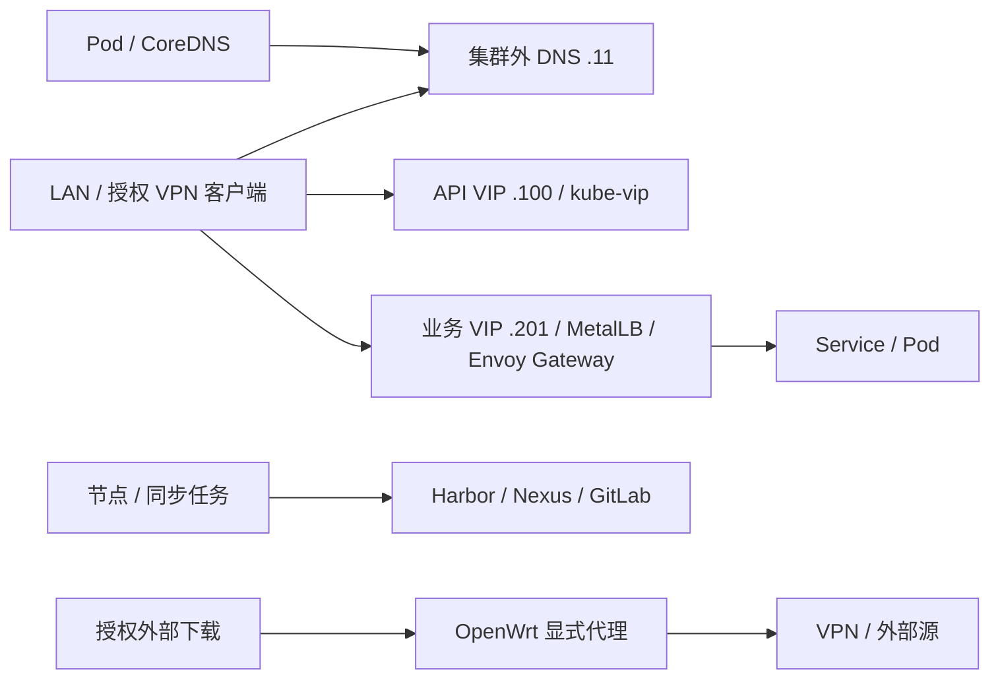

# 网络拓扑与 DNS 职责

## 1. 基础路径

起步复用 `192.168.9.0/24` 节点/管理 LAN。主路由的地址现场确认，OpenWrt `.10` 是旁路由，不能在未验证时替换所有节点默认网关。内网 DNS `.11` 独立于 Kubernetes 和 VPN。

内网访问路径不依赖 VPN。要求走 VPN 的流量在隧道断开时停止，不静默改走直连；允许直连的任务使用单独策略。

## 2. 域名与解析

公网根域 `egon.top`；内部根域 `internal.egon.top`；管理、平台、内部服务分别使用 `mgmt`、`k8s`、`svc` 子域。Harbor 虽使用 `harbor.k8s.internal.egon.top`，仍部署在集群外；命名分类不决定部署位置。

基础 DNS 对内部域提供权威记录并解析其他公网名称；CoreDNS 管理 `cluster.local`，其他查询转给基础 DNS。`networking.dnsDomain` 与 kubelet `clusterDomain` 均为 `cluster.local`；基础 DNS 不把内部域反向转给 CoreDNS。

Mac、Rocky、VPN、浏览器、Git 和构建镜像分别验证系统实际解析路径；`dig @192.168.9.11` 成功不能代表客户端已正确配置。内部 CA 信任另行分发，DNS 正常不能代替 TLS 检查。

## 3. Pod、Service 与入口

主集群 Pod CIDR `10.244.0.0/16`，Cilium 每节点 `/24`；Service CIDR `192.168.20.0/24`。Service 地址为集群虚拟地址，不配置物理 VLAN、LAN DHCP 或默认路由。

00 完成主机转发、Overlay 端口与路由前置；01 安装 Cilium Overlay 并保留 kube-proxy；02 再独立测试 kube-proxy replacement。API VIP 由 kube-vip 管，`.201–.210` 业务池由 MetalLB 管；`.211–.220` 为隔离对照预留，使用前核实 Cilium L2/BGP 前置。[Cilium 官方前置](https://docs.cilium.io/en/stable/network/l2-announcements/)

Envoy Gateway/Gateway API 是应用入口主线；Ingress 在独立 IngressClass/地址上对照。HTTPS、gRPC、SNI/Host、证书续期、EndpointSlice 变化、拒绝流量都纳入 02 验收。Hubble 在网络阶段就用于定位策略和转发，不等待 05。

## 4. 出口、存储与多集群

代理绕行覆盖内部域、`cluster.local`、节点/Pod/Service CIDR 和回环地址，各语言分别测试 CIDR 支持。Ceph 流量走节点网络，先确认实际 SNAT 和回程路径，再收紧防火墙。

BGP 需要可控的真实或隔离软件路由器；独立存储网、VLAN、Jumbo Frame 需端到端支持再启用。第二集群 Pod `10.245.0.0/16`、Service `10.96.0.0/16`，节点地址和 API VIP 待核实分配；提前检查家庭网络、VPN 远端与所有容器桥接网段的重叠。

## 5. 域名与客户端解析约定

### 企业内部根域名为 internal.egon.top

公网根域名为 egon.top，企业内部根域名为 internal.egon.top。内部入口按职责划分为以下三个子域：

| 用途 | 内部子域 | 入口示例 |
| --- | --- | --- |
| 基础设施 | mgmt.internal.egon.top | esxi01.mgmt.internal.egon.top、vcsa.mgmt.internal.egon.top、idrac01.mgmt.internal.egon.top |
| 云原生平台 | k8s.internal.egon.top | argocd.k8s.internal.egon.top、grafana.k8s.internal.egon.top、harbor.k8s.internal.egon.top |
| 内部服务 | svc.internal.egon.top | gitlab.svc.internal.egon.top、mysql.svc.internal.egon.top |

其余基础设施使用 openwrt.mgmt.internal.egon.top、dns.mgmt.internal.egon.top、admin.mgmt.internal.egon.top、ceph.mgmt.internal.egon.top。第二、三台宿主机和带外管理分别使用 esxi02.mgmt.internal.egon.top、esxi03.mgmt.internal.egon.top、idrac02.mgmt.internal.egon.top、idrac03.mgmt.internal.egon.top。

节点使用 cp01.k8s.internal.egon.top、cp02.k8s.internal.egon.top、cp03.k8s.internal.egon.top、infra01.k8s.internal.egon.top、infra02.k8s.internal.egon.top、storage01.k8s.internal.egon.top、storage02.k8s.internal.egon.top、storage03.k8s.internal.egon.top、worker01.k8s.internal.egon.top、worker02.k8s.internal.egon.top。

主集群 API 使用 api.k8s.internal.egon.top。Jenkins、Backstage、Keycloak 的平台入口分别使用 jenkins.k8s.internal.egon.top、backstage.k8s.internal.egon.top、keycloak.k8s.internal.egon.top。Nexus、对象存储与内部业务入口使用 nexus.svc.internal.egon.top、s3.svc.internal.egon.top、各服务.svc.internal.egon.top，例如 demo.svc.internal.egon.top，并映射到实际受控端点。

域名分组表示入口职责，不改变组件的部署位置；Harbor、GitLab、Nexus 仍按自举要求部署在集群外。平台入口可以复用统一网关，不意味着必须额外部署独立 VM。

### 集群内部服务域保留 cluster.local

Kubernetes 的 Service DNS 后缀保留默认 cluster.local，服务全名采用 service.namespace.svc.cluster.local，例如 kubernetes.default.svc.cluster.local。kubeadm 的 networking.dnsDomain 与 kubelet 的 clusterDomain 均保持 cluster.local，不随企业内部域名调整。[配置依据](references.md#k02)；[服务发现依据](references.md#k07)。

CoreDNS 对 cluster.local 提供集群服务解析，其他查询转给集群外 DNS。基础 DNS 管理 internal.egon.top，不把该内部域转回 CoreDNS。Helm Chart、Operator、Istio、SDK 和模板沿用 cluster.local；节点、API 和平台入口使用企业内网域名。

### 内部 DNS 与客户端解析

集群外 DNS 对 internal.egon.top 及其 mgmt、k8s、svc 子域提供内部权威记录；egon.top 的其他公网名称按上游正常解析，基础 DNS 不接管整个 egon.top。内网记录供 LAN/VPN 客户端使用，公网 DNS 默认不发布内网服务地址或入口。[职责与分视图依据](references.md#r01)。

Phase 00 配置 macOS、Rocky、VPN、浏览器、构建镜像和各语言客户端的内部 DNS 路径；按需为 internal.egon.top 设置分域解析及 DoH 例外。验收必须使用实际系统解析器和业务客户端，不以直接向某个 DNS 发出一次查询成功作为全部通过。内部 CA 与 DNS 是独立问题：解析正确并不代表证书自动受信任。

### 公网域名统一为 egon.top

只为明确批准公开的应用创建 egon.top 子域，例如 demo.apps.egon.top、api.egon.top。域名所有权与 DNS API 权限在 Phase 00 核实；本文件不声称已替用户查询、配置或发布任何公网记录。

有公网域名不等于有公网 IP、入站端口或可用隧道。是否公开、如何入站、TLS 如何终止与回源都须单独验收。内部 GitLab、Harbor、Nexus、Kubernetes API、Ceph、数据库及监控管理界面默认不公开。内外应用即使落到同一网关，也必须分别匹配 Host、SNI、证书和授权。
