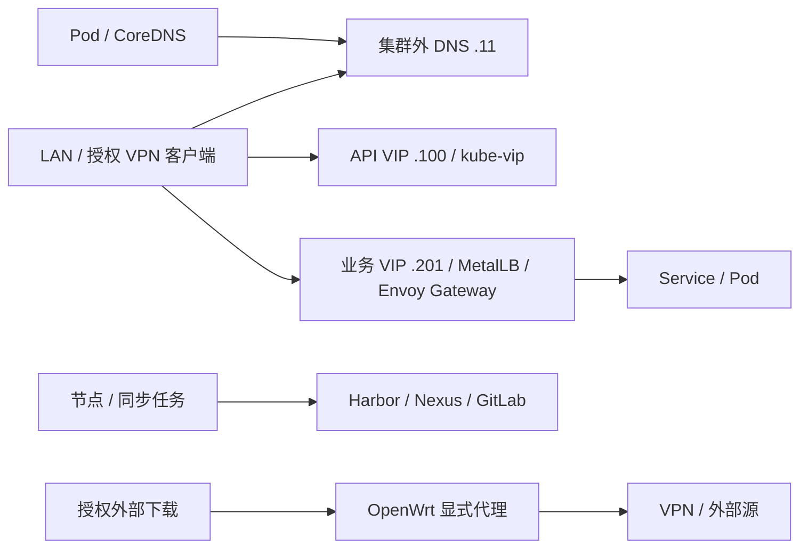

# 网络拓扑与 DNS 职责

## 1. 基础路径

起步复用 `192.168.9.0/24` 节点/管理 LAN。主路由的地址现场确认，OpenWrt `.10` 是旁路由，不能在未验证时替换所有节点默认网关。内网 DNS `.11` 独立于 Kubernetes 和 VPN。

内网访问路径不依赖 VPN。要求走 VPN 的流量在隧道断开时停止，不静默改走直连；允许直连的任务使用单独策略。

## 2. 域名与解析

公网根域 `egon.top`；内部根域 `internal.egon.top`；管理、平台、内部服务分别使用 `mgmt`、`k8s`、`svc` 子域。Harbor 虽使用 `harbor.k8s.internal.egon.top`，仍部署在集群外；命名分类不决定部署位置。

基础 DNS 对内部域提供权威记录并解析其他公网名称；CoreDNS 管理 `cluster.local`，其他查询转给基础 DNS。`networking.dnsDomain` 与 kubelet `clusterDomain` 均为 `cluster.local`；基础 DNS 不把内部域反向转给 CoreDNS。

Mac、Rocky、VPN、浏览器、Git 和构建镜像分别验证系统实际解析路径；`dig @192.168.9.11` 成功不能代表客户端已正确配置。内部 CA 信任另行分发，DNS 正常不能代替 TLS 检查。

## 3. Pod、Service 与入口

主集群 Pod CIDR `10.244.0.0/16`，Cilium 每节点 `/24`；Service CIDR `192.168.20.0/24`。Service 地址为集群虚拟地址，不配置物理 VLAN、LAN DHCP 或默认路由。

00 完成主机转发、Overlay 端口与路由前置；01 安装 Cilium Overlay 并保留 kube-proxy；02 再独立测试 kube-proxy replacement。API VIP 由 kube-vip 管，`.201–.210` 业务池由 MetalLB 管；`.211–.220` 为隔离对照预留，使用前核实 Cilium L2/BGP 前置。[Cilium 官方前置](https://docs.cilium.io/en/stable/network/l2-announcements/)

Envoy Gateway/Gateway API 是应用入口主线；Ingress 在独立 IngressClass/地址上对照。HTTPS、gRPC、SNI/Host、证书续期、EndpointSlice 变化、拒绝流量都纳入 02 验收。Hubble 在网络阶段就用于定位策略和转发，不等待 05。

## 4. 出口、存储与多集群

代理绕行覆盖内部域、`cluster.local`、节点/Pod/Service CIDR 和回环地址，各语言分别测试 CIDR 支持。Ceph 流量走节点网络，先确认实际 SNAT 和回程路径，再收紧防火墙。

BGP 需要可控的真实或隔离软件路由器；独立存储网、VLAN、Jumbo Frame 需端到端支持再启用。第二集群 Pod `10.245.0.0/16`、Service `10.96.0.0/16`，节点地址和 API VIP 待核实分配；提前检查家庭网络、VPN 远端与所有容器桥接网段的重叠。
