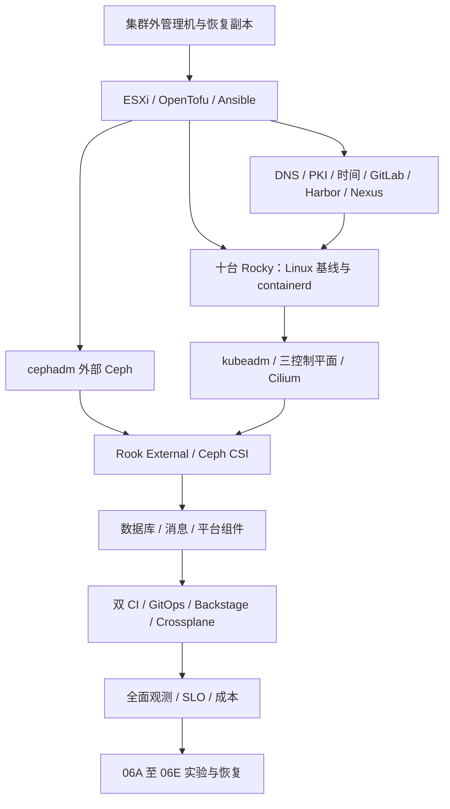

# 总体架构

本文件定义目标结构与职责，当前状态为规划待执行。既有域名、十节点角色、三台 ESXi 和外部 Ceph 方向保持不变。参数明细见 [主机](../../inventory/hosts.yaml)、[网络](../../inventory/networks.yaml)、[资源](../../inventory/resources.yaml) 台账；这些设计值均需现场核实。

## 1. 五层职责

| 层次 | 部署与控制者 | 交付范围 |
| --- | --- | --- |
| 物理与虚拟化 | ESXi、OpenTofu | 虚拟网络、VM、虚拟硬件、OS 与数据盘映射 |
| 集群外基础服务 | Ansible、OpenWrt、DNS/PKI、Harbor/Nexus/GitLab、cephadm | 系统、CRI、软件供应、基础身份与存储服务 |
| Kubernetes 平台 | kubeadm、Cilium、CSI、网关与 Operator | 调度、网络、存储消费和平台资源 |
| 交付与开发者平台 | GitLab CI/Jenkins、Argo CD、Backstage、Crossplane | 构建、发布、环境配置、自助申请 |
| 实验与验收 | labs、tests、reports | 功能、故障、性能、安全、容灾的可重复证据 |

箭头表示建设依赖，不表示所有服务都部署在 Kubernetes。GitLab、Harbor、Nexus、DNS、CA 恢复材料、管理工具与初始 IaC State 必须在主集群及其 Ceph 不可用时仍可恢复。

## 2. Phase 00 与 Phase 01 的交接

00 负责创建并初始化服务器：Rocky 安装、VMXNET3、唯一身份、静态网络、DNS/时间/CA、系统软件源、磁盘挂载、cgroup/Swap、内核、防火墙/SELinux 策略、containerd/runc/crictl、镜像预热与 CRI 自测。十台节点经重启复验后才能交接。

01 只复核交接基线，再配置 kubeadm/kubelet、执行 init/join、部署 kube-vip 和 Cilium，验证控制器。节点初始化不合格时返回 00 修复相应 Playbook，不能在 01 手工补一套无法复用的系统配置。00 预装工具不等于提前创建集群；CNI 就绪和十节点 Ready 是 01 的验收。

## 3. 主方案与对照实验

主方案使用 kubeadm + stacked etcd、containerd、Cilium Overlay、kube-vip API VIP、MetalLB 业务 VIP、Envoy Gateway/Gateway API、cephadm + Rook External/CSI、Argo CD。GitLab CI 与 Jenkins 都是完整交付主线，覆盖 Java、Rust、C、C++、C#、JS/TS、Python。

Rook 自管理 Ceph、Ingress 对照、Cilium kube-proxy replacement/L2/BGP、Istio 两种模式、Flux、Tekton、ELK/Loki 对照均保留实施和验收；按需运行控制资源消耗。对照不能同时管理主方案的磁盘、VIP 或同一 Kubernetes 对象。[控制权与启停规则](dependencies-and-ownership.md) 定义执行边界。

## 4. 分环境与跨阶段依赖

`dev`、`staging`、`prod-like` 起步为主集群中的逻辑环境，使用独立 Namespace、配额、凭据与发布参数；不预设已有三套物理集群。第二集群在 06C 通过容量与地址检查后创建。

安全、备份和基本故障诊断从 00 开始。04 为灰度发布部署最小真实指标源并完成自动回退；05 才统一完整遥测和 SLO，避免 04 的验收反向依赖 05。02 基础网格与身份实验在本阶段验证，04–06 只扩展发布、观测和跨服务信任。

## 5. 专题架构

- [物理拓扑](physical-topology.md)：VM 放置、故障域与磁盘来源。
- [网络拓扑](network-topology.md)：流量、DNS、出口和 VIP 控制者。
- [IP 地址规划](ip-address-plan.md)：地址池、域名与启用检查。
- [存储架构](storage-architecture.md)：Ceph、CSI、中间件和独立备份。
- [安全架构](security-architecture.md)：主机、身份、供应链和恢复权限。
- [资源容量](resource-capacity.md)：预算、常驻集合和高级实验条件。

版本兼容与硬件能力均需锁定和验证；设计约束不构成厂商认证或高可用实测结论。
